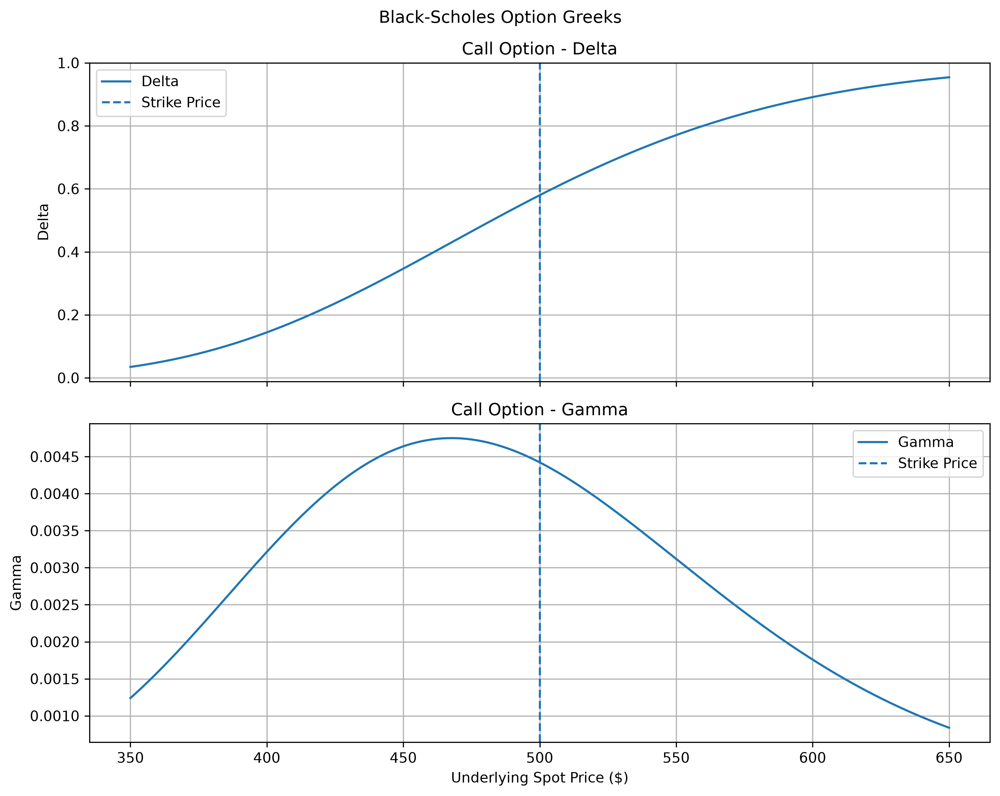

# Derivatives Pricing & Monte Carlo Risk Engine

A Python-based quantitative finance project for European option pricing, Monte Carlo simulation, option Greeks, volatility analysis, and portfolio risk measurement.

## Key Features

- Black-Scholes pricing for European call and put options.
- Monte Carlo simulation for option pricing with standard error estimation.
- Option Greeks: Delta, Gamma, Theta, Vega, and Rho.
- Historical and rolling volatility analysis using SPY market data.
- Historical Value at Risk (VaR) and Expected Shortfall (ES).
- Automated tests for pricing and risk calculations.

## Technology Stack

- Python, NumPy, pandas, SciPy
- Matplotlib
- yfinance and pandas-datareader
- pytest

## Risk Analytics Results

Portfolio value: **,000**

| Confidence Level | Daily VaR | Daily Expected Shortfall |
|---|---:|---:|
| 95% | ,676.18 | ,515.95 |
| 99% | ,972.83 | ,958.76 |

VaR estimates a loss threshold at a specified confidence level. Expected Shortfall estimates the average loss in the tail beyond that threshold. These results are historical estimates and are not forecasts or investment advice.

## Pricing Model Validation

Monte Carlo option prices were compared against analytical Black-Scholes prices using 200,000 simulations. The simulation used a fixed random seed of 42 for reproducibility.

| Metric | European Call | European Put |
|---|---:|---:|
| Black-Scholes Price | .0400 | .1393 |
| Monte Carlo Price | .1018 | .2197 |
| Monte Carlo Standard Error | .1363 | .0965 |
| Absolute Price Difference | .0618 | .0804 |
| Validation | PASS | PASS |

Both simulated prices were within three Monte Carlo standard errors of their analytical benchmarks. The results demonstrate numerical agreement for the tested parameter configuration.

## Option Greeks Visualisation

The following charts illustrate how Delta and Gamma change with the underlying asset price under the Black-Scholes model, keeping strike price, maturity, risk-free rate, and volatility fixed.

### European Call Option

### European Put Option

### Interpretation

- **Call Delta:** Generally increases as the underlying asset price rises.
- **Put Delta:** Generally increases toward zero as the underlying asset price rises.
- **Gamma:** Measures the sensitivity of Delta to changes in the underlying asset price. For standard European options under Black-Scholes assumptions, Gamma is the same for calls and puts with identical inputs and is typically highest near the strike price.

